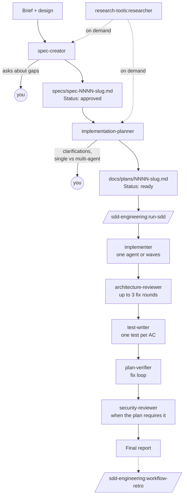

# sdd-engineering

Spec-Driven Development for Claude Code. A feature goes from a brief to
verified code in fixed steps: a spec with testable acceptance criteria, a
Development Plan, implementation, architecture review, tests, verification
against every criterion, and a security review. Each step is a dedicated
agent; `/sdd-engineering:run-sdd` runs the build half for you and stops only
where you must decide.

## Install

```
/plugin marketplace add Saphirox/dev-digest-ai-marketplace
/plugin install sdd-engineering@dev-digest
```

This also installs its dependencies:

| Plugin | Why |
|--------|-----|
| `engineering-foundations` | Shared skills and the read-only Bash guard for the reviewer, planner and verifier |
| `architecture-reviewer` | Review step of `run-sdd` |
| `research-tools` | `researcher`, which the spec and plan agents ask for when they need outside facts |
| `dev-digest-stack` | Stack skills the planner, implementer and test-writer apply |

Requires Node.js 20+ for the hooks and scripts.

## Components

| Type | Name | Model | Writes |
|------|------|-------|--------|
| Agent | `spec-creator` | opus | `specs/spec-NNNN-<slug>.md` and its design frames only |
| Agent | `implementation-planner` | opus | nothing (the main session saves its plan) |
| Agent | `implementer` | sonnet | code, tests, `INSIGHTS.md` |
| Agent | `test-writer` | sonnet | test files only |
| Agent | `plan-verifier` | opus | nothing |
| Agent | `security-reviewer` | opus | nothing |
| Skill | `run-sdd` | | manual: `/sdd-engineering:run-sdd` |
| Skill | `workflow-retro` | | manual: `/sdd-engineering:workflow-retro`; writes `docs/retro/ledger/` |
| Skill | `spec-writing` | | spec template, EARS rules, checklists, `scripts/lint.mjs` |
| Hook | `spec-creator-hook.mjs` | | limits `spec-creator` writes to specs and lints each spec it writes |

Agents are addressed as `sdd-engineering:<name>`, for example
`@agent-sdd-engineering:spec-creator`.

## How it works



### 1. Spec: `spec-creator`

Give it a feature brief and, ideally, a design (screenshots or a page it can
open with the Chrome tools). It checks the design against the `spec-writing`
gap checklists, asks you about every gap, and writes
`specs/spec-NNNN-<slug>.md`: acceptance criteria in EARS form (`AC-n`), edge
cases, NFRs, module tags and traceability. Every write is linted. You review
the draft and set `Status: approved`.

### 2. Plan: `implementation-planner`

Reads the approved spec (or a concrete task), asks about anything unclear and
whether to run single-agent or multi-agent, and returns a Development Plan:
files, ordered steps, the skills each step must apply, constraints, verify
commands, and a work split into waves. The main session saves it as `docs/plans/NNNN-<slug>.md`
with `**Status:** ready`.

### 3. Build: `/sdd-engineering:run-sdd <plan or spec>`

The main session orchestrates; subagents cannot spawn agents.

1. **Build:** `implementer` runs the plan, as one agent or wave by wave.
2. **Architecture review:** this run's files are staged and
   `architecture-reviewer` reviews them; `critical` and `warning` findings
   go back to `implementer`, up to three rounds.
3. **Tests:** `test-writer` adds one test per acceptance criterion.
4. **Verify:** `plan-verifier` checks every `AC`, edge case, NFR and plan
   item with runtime evidence; its fix list goes back to `implementer` or
   `test-writer`.
5. **Security:** `security-reviewer` traces the diff source to sink when
   the plan marks security as required.
6. **Report:** what was done, what was deferred, what needs you.

Progress lives in `docs/plans/NNNN-<slug>.state.json`, so `--resume`
continues after a compaction or in a new session. Pass a quoted string to
give every implementer extra notes. `--docs` runs a `doc-writer` agent only
if your project defines one; this plugin does not ship it.

### 4. Retro: `/sdd-engineering:workflow-retro [deep]`

After a run, it reports tokens, agent order and waves, what each agent
struggled with, and duplicated or missed information, then proposes changes
to agents, skills and the pipeline. It writes only a ledger entry under
`docs/retro/ledger/`; you decide what to apply.

## Guard rails

- `spec-creator` may write only `specs/spec-NNNN-<slug>.md` and
  `specs/images/spec-NNNN/*.png` (hook in this plugin).
- `implementation-planner`, `plan-verifier` and `security-reviewer` run Bash
  through read-only allowlists (hook in `engineering-foundations`).
- No agent commits or pushes. Review findings are advisory: you decide what
  gets fixed.

## Project conventions

The agents read and write these paths in your repo:

| Path | Written by |
|------|------------|
| `specs/spec-NNNN-<slug>.md`, `specs/images/spec-NNNN/` | `spec-creator` |
| `docs/plans/NNNN-<slug>.md` | main session, from the planner's output |
| `docs/plans/NNNN-<slug>.state.json` | `run-sdd` |
| `docs/retro/ledger/` | `workflow-retro` |
| `INSIGHTS.md` per module | `implementer`, `test-writer` |
| `AGENTS.md` / `CLAUDE.md` | you; agents read module rules and commands from them |

The prompts were written for the dev-digest repo (`client/`, `server/`,
`reviewer-core/`, `mcp/`, pnpm). In another layout, describe your modules and
check commands in `AGENTS.md` or `CLAUDE.md`.

## Releases

Versions follow semver; see [CHANGELOG.md](CHANGELOG.md).

| Version | Requires |
|---------|----------|
| 0.1.0 | `engineering-foundations` ^0.1.0, `architecture-reviewer` ^0.1.0, `research-tools` ^0.1.0, `dev-digest-stack` ^0.1.0 |
